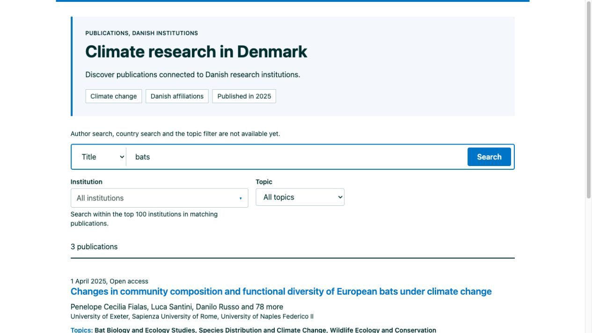

# OpenAlex publications

A research explorer for climate-related publications associated with Danish institutions and published in 2025. Built with React, Hono and the OpenAlex API.

The repository contains two parts:

- A TypeScript import script that stores 1,000 publications in SQLite and updates existing records on subsequent imports.
- A web application with title search, a searchable institution filter, pagination and publication details. It queries OpenAlex directly, so users can explore more than the imported records.



The detail page shows the abstract, citation count, access status, publication links and author affiliations. Long author and institution lists expand on demand.


I developed the application in vertical slices and chose tools I could work with and explain. AI helped with implementation and review in small steps. [PROMPTS.md](PROMPTS.md) records the prompts, division of work and verification.

## Scope

The import, publication list, details, title search and single-institution filter work locally. List and detail requests have loading skeletons, error messages and manual retry. Empty results have a separate message.

Author and country search, the topic filter, extra analysis and public deployment are not implemented. The search-type selector and topic filter remain disabled in the UI. Only one of the exercise's two required filters is complete.

## Run locally

### Prerequisites and configuration

Development used Node.js 22.14.0 and npm. Run all commands from the repository root.

Install dependencies:

```bash
npm ci
```

Create a `.env` file in the repository root containing your OpenAlex API key:

```dotenv
OPENALEX_API_KEY=your_key
```

The server and import script load this file. It is excluded from Git, along with the local database and dependencies. The browser never receives the API key.

### Start the application

Start Hono in one terminal:

```bash
npm run dev:server
```

Start Vite in another:

```bash
npm run dev:client
```

Hono listens on port 3000. Open the frontend URL printed by Vite, usually `http://localhost:5173`. Vite forwards `/api` requests to Hono.

The web application does not require the SQLite database or an import run.

### Import publications

```bash
npm run import
```

The script creates `publications.sqlite` in the working directory. It requests ten pages of 100 publications, waits one second between pages and stops early if a page is empty. Each page is saved before the next request. Rerunning starts at page 1 and uses the OpenAlex ID to insert or update each record without duplicates. Saved records remain if a later request fails.

## Architecture and data

| Component                | Responsibility                                                                   |
| ------------------------ | -------------------------------------------------------------------------------- |
| React, Vite and Tailwind | Pages, layout and styling                                                        |
| React Router             | List/detail navigation and search criteria in the URL                            |
| TanStack Query           | API request state and in-memory caching                                          |
| Base UI                  | Searchable institution combobox with local Tailwind styling                      |
| Hono on Node.js          | Validate parameters, enforce the collection scope and call OpenAlex              |
| SQLite import script     | Retrieve and store the separate 1,000-record dataset                             |
| Shared types and mapping | Convert OpenAlex responses into the publication model used by import and backend |

The browser calls Hono, which queries OpenAlex and returns mapped publication data. SQLite is used by the import script only. I chose the API search approach because I have no Elasticsearch experience, and SQLite because I have some familiarity with it and it needs little setup.

### Publication model

We retain the fields needed by the list and details: ID, title, date, citation count, abstract, DOI, external links, open access information, topics and author affiliations.

Each author keeps their position in the list, their `first`/`middle`/`last` value and their own institutions with country codes. This preserves multiple affiliations and allows the UI to derive a combined institution list without duplicates. Countries describe affiliations, not nationality. Missing optional metadata is expected; the UI uses fallback text.

SQLite stores simple values in columns and authorships/topics as JSON text. This keeps the nested relationships without many tables. Separate tables would make extensive SQL analysis easier. The import reconstructs readable abstracts from OpenAlex's word positions and stores missing abstracts as `null`.

See the [field-by-field publication model](docs/publication-model.md) for column names and an example object.

### Search, filters and caching

The URL stores the committed title query, institution ID and page. Text being typed stays in local React state until submit. A new search or institution selection resets the page to 1. Clear filters removes the institution while preserving the title query.

The institution endpoint groups the matching publications and returns the 100 institutions with the most matches, sorted alphabetically. Options follow the title query, independently of the selected institution and page. They include international collaborators. Typing in the combobox searches only these downloaded options.

TanStack Query caches results by search criteria and page, considers them fresh for five minutes and disables automatic frontend retries. A full reload clears the cache. Details can reuse list data with its original update time; direct links fetch through the backend when needed.

## Verification

```bash
npm test
npm run typecheck
```

Nine Vitest tests cover abstract reconstruction, detail responses, invalid IDs, safe upstream errors and subsequent recovery, institution validation and preservation of the fixed scope in API queries. They simulate OpenAlex responses and need no live API key. Tests and type checking passed on 15 November 2026. A frontend production build also passed during development.

Manual checks covered the 1,000-row database, upsert, pagination and URL navigation, loading/error/empty states, list keyboard and narrow-screen behaviour, direct detail loading, author expansion and combobox search/selection. Upsert was checked by importing a test title and then restoring the real title without adding a duplicate row.

There is no automated frontend interaction suite. OpenAlex retry branches have not been explicitly tested. The [list story](docs/stories/01-publication-list.md) and [detail story](docs/stories/02-publication-details.md) record checks and outstanding manual verification. Use `npm run format` to format the project.

## Assumptions and limitations

- Scope means matching OpenAlex's `climate change` search, at least one Danish institutional affiliation and a publication date in 2025. We do not manually assess climate relevance.
- The app depends on OpenAlex availability, API budget and metadata quality. TypeScript describes the expected responses but does not validate them at runtime.
- Institution options are limited to the top 100. Basic pagination exposes at most the first 10,000 matching publications.
- Result cards show three authors and derive the institution summary from those authors. An institution associated with a later author may explain a search match but be absent from that summary. Details use all returned authorships.
- Browser timeouts are 10 seconds for lists, 30 for details and 15 for institution options. Backend publication requests retry HTTP 429 and server errors up to three times, normally after 2, 4 and 8 seconds, respecting a valid `Retry-After` for 429. They have no explicit upstream timeout and do not retry network failures. Institution requests have a ten-second timeout without automatic retries. Browser cancellation does not stop backend work.
- Import upserts update matching rows even when their stored values are unchanged. JSON storage preserves the author list order; `author_position` alone cannot order multiple middle authors.

## Possible next steps

Complete the second filter and author/country search. Make institution summaries explain search matches independently of truncated author names. Add frontend interaction tests for filter changes, pagination reset and navigation back to the same search.

Further work could consolidate HTTP handling, validate external responses, skip unchanged database writes and organise the client by feature as it grows.

## Deployment

Local execution is supported as described above. Public deployment has not been configured or verified. The intended deployment is one Node service serving both the API and the built React application. It would require:

- Build/start scripts for the frontend and backend (not currently present).
- Serving built frontend assets through Hono, with a React Router fallback for frontend routes and separate API 404 handling.
- Reading the listening port from the host's `PORT` variable instead of the current fixed 3000.
- A compatible Node runtime, build dependencies and `OPENALEX_API_KEY` configured in the hosting environment.
- Local production-mode verification followed by hosted smoke checks.

The SQLite file is not needed by the deployed web app. Do not deploy `.env` or expose the API key to the frontend.

## Further documentation

- [AI usage and selected prompts](PROMPTS.md)
- [Architecture decisions](docs/architecture.md)
- [Design exploration and prototype](docs/design/README.md), an earlier reference rather than the current UI

The UI takes visual cues from [Research Portal Denmark](https://local.forskningsportal.dk/search/78730) and [Statistics Denmark](https://www.dst.dk/da/Statistik/emner/borgere/navne/hvor-mange-hedder). The current implementation uses dark text, blue actions and an introduction with background `#F4F7FC` and a `4px` blue border in `#0074c6`.
