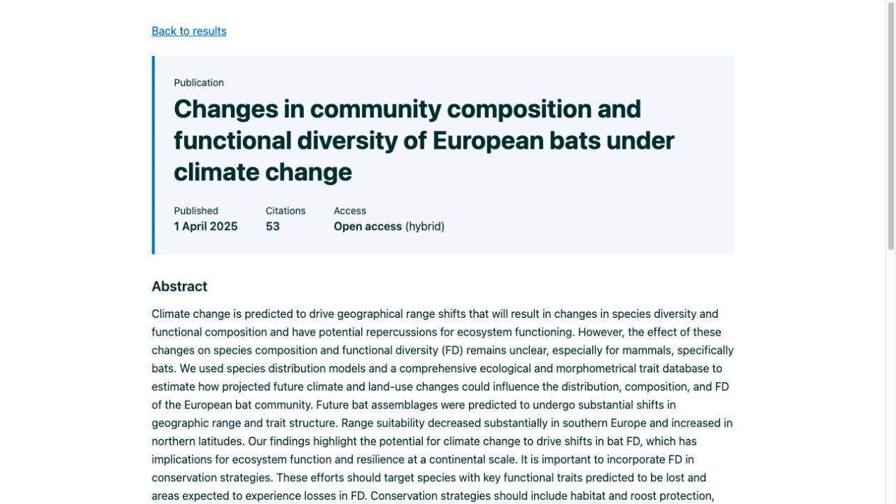

# OpenAlex publications

A full-stack coding exercise exploring climate-related publications from Danish institutions, published in 2025.

This repository covers two distinct but connected parts of the exercise:

1. **Data extraction and storage:** A TypeScript script retrieves 1,000 publications from OpenAlex and stores selected metadata in SQLite. It preserves author affiliations and updates existing publications when the import is rerun.
2. **Research explorer:** A small Hono and React application lets users browse publications, search by title, filter by institution and open publication details. It queries OpenAlex directly, so results are not limited to the 1,000 imported records.

Both parts focus on climate-related publications associated with Danish institutions and published in 2025. They share the same publication model and mapping, while the SQLite import and live search have separate responsibilities.

### Explore publications

The application combines title search, a searchable institution selector and pagination. Active search criteria are stored in the URL, so a search can be shared or restored when returning from a publication.


### Inspect a publication

The detail page brings together the abstract, citation count, access status and publication links. Author affiliations and a deduplicated institution list can be expanded when needed, keeping large collaborations manageable to read.



### A few decisions behind the solution

- **A working flow before more features:** Development followed vertical slices, starting with a real publication list from React through Hono to OpenAlex, then adding details, search and institution filtering.
- **A deliberate data model:** The import stores fields needed by the interface rather than the entire API response. Authors retain their order and their individual institutional affiliations.
- **AI-assisted, with developer review:** I worked through the implementation in small steps, questioned suggestions and checked the results. [PROMPTS.md](PROMPTS.md) records the division of work and verification.

## Scope and status

The import script has stored 1,000 publications in SQLite. The web application supports a paginated publication list, title search, a searchable single-institution filter and publication details. List and detail loading use skeletons; failures offer manual retry.

The solution is intentionally partial. Author/country search and the topic filter are visible but disabled. Only one of the exercise's two required filters is implemented. Additional analysis and public deployment have not been completed.

## Architecture

React, TypeScript, Vite and Tailwind form the frontend, with React Router for navigation and URL state, TanStack Query for server state, and Base UI for the institution combobox. Hono runs on Node.js and calls OpenAlex with the API key kept server-side.

The web application reads from OpenAlex, not SQLite. The database independently demonstrates data extraction and storage. Import and backend share the publication mapping and types. See [application architecture](docs/architecture.md) for the original decisions.

Implementation records: [publication list](docs/stories/01-publication-list.md) and [publication details](docs/stories/02-publication-details.md). These distinguish completed checks from remaining manual verification.

## Running the import

Development uses Node.js 22.14.0 and npm.

1. Run `npm ci`.
2. Create `.env` in the project root containing `OPENALEX_API_KEY=your_key`.
3. Run `npm run import`.

The script creates `publications.sqlite` in the current working directory, so run it from the project root. The environment file and database are excluded from Git. Run `npm run format` to format the code.

## Running the web application

After installing dependencies and creating `.env` as above, run these commands in separate terminals:

- `npm run dev:server` starts Hono on port 3000.
- `npm run dev:client` starts Vite; open the URL printed in its terminal.

Vite proxies `/api` requests to Hono. The list shows 10 records per page and stores the page in the URL. TanStack Query caches each page in memory; a full reload clears that cache. Frontend timeouts are 10 seconds for lists, 30 seconds for details and 15 seconds for institution options. Queries are considered fresh for five minutes; automatic frontend retries are disabled.

## Data and technical decisions

- TypeScript is used for the import script and SQLite for local storage. SQLite was chosen because I have some familiarity with it and it requires minimal setup.
- We store fields relevant to the results list and detail view rather than the entire API response: title, date, links, citation count, abstract, open access information, author affiliations and topics.
- Simple values are stored in columns. Author affiliations and topics are stored as JSON text to preserve their nested structure without introducing many tables. Separate tables would make extensive SQL analysis of these relationships easier.
- The OpenAlex ID is the primary key. The import inserts new publications and updates existing ones, preventing duplicates when rerun.
- Author order and `author_position` are preserved. Institutions and their countries are nested under each author. The UI's combined institution list is derived from these affiliations and deduplicated by institution ID.
- Abstracts are reconstructed from OpenAlex's word positions. Missing abstracts are stored as `null`.

## Publication model

Each row in `publications` represents one OpenAlex publication. The import maps the API response to a smaller application object, then stores it as follows:

| Application field         | SQLite column      | Content                                          |
| ------------------------- | ------------------ | ------------------------------------------------ |
| `id`                      | `id`               | OpenAlex ID; primary key used for upsert         |
| `title`                   | `title`            | Publication title                                |
| `publicationDate`         | `publication_date` | Date as `YYYY-MM-DD` text                        |
| `citationCount`           | `citation_count`   | Integer citation count                           |
| `doi`                     | `doi`              | DOI URL, or `null`                               |
| `landingPageUrl`          | `landing_page_url` | Publication page URL, or `null`                  |
| `abstract`                | `abstract`         | Reconstructed abstract text, or `null`           |
| `openAccess.isOpenAccess` | `is_open_access`   | Boolean stored as integer `0` or `1`             |
| `openAccess.status`       | `oa_status`        | OpenAlex open access status                      |
| `openAccess.url`          | `oa_url`           | Open access URL, or `null`                       |
| `authorships`             | `authorships_json` | Ordered author affiliations, stored as JSON text |
| `topics`                  | `topics_json`      | Topic IDs and names, stored as JSON text         |

The nested fields have this shape (illustrative values):

```json
{
  "authorships": [
    {
      "authorId": "https://openalex.org/A123",
      "authorName": "Example Author",
      "authorPosition": "first",
      "institutions": [
        {
          "id": "https://openalex.org/I123",
          "name": "Example University",
          "countryCode": "DK"
        }
      ]
    }
  ],
  "topics": [
    {
      "id": "https://openalex.org/T123",
      "name": "Example topic"
    }
  ]
}
```

An author ID or institution country code may be `null`, and the lists may be empty. Each author can have multiple institutions. Countries describe institutional affiliations, not author nationality. `authorPosition` is `first`, `middle` or `last`; the array order is also preserved because multiple authors can be `middle`.

The results list can use title, date, authors, institutions and topics. The detail view additionally uses the abstract, full author affiliations, citation count, links and open access information. A combined institution list is derived from the authorships and deduplicated by institution ID, rather than stored a second time.

## Import behaviour

The import requests 10 pages of 100 publications sequentially, saving each page before requesting the next. It waits one second between pages and stops early if a page is empty. API requests are kept in `src/openalex.ts`; pagination, mapping and storage are handled by `src/import-publications.ts`.

HTTP 429 and server errors (5xx) trigger up to three retries, normally after 2, 4 and 8 seconds. For 429 responses, `Retry-After` is honoured when valid. Network failures without an HTTP response are not retried. Previously saved rows remain available if a later request fails; rerunning the script starts from page 1 and updates existing records.

## Manual verification so far

A publication was fetched, transformed and inspected in SQLite Viewer. Upsert was tested by importing the title as `TEST`, then importing the original title again. There was still only one row with that ID. The import was expanded incrementally, first to multiple publications, then two pages, and finally 10 pages. The completed import was verified to contain 1,000 rows in SQLite.

Run `npm test` for nine Vitest tests covering abstract reconstruction, detail success/400/404/502 and subsequent recovery, institution validation, and scope-preserving query construction. Upstream responses are simulated; tests do not use a live API key. Run `npm run typecheck` for static type checking. Both checks were rerun successfully on 15 November 2026. The frontend build also passed during implementation.

Browser checks during development covered list navigation, loading/error/empty states, list keyboard/narrow-screen behaviour, direct detail loading, author expansion, out-of-scope details and combobox search/selection updating the URL. These are manual checks, not an automated browser suite. Remaining detail-specific checks are recorded in the detail story. OpenAlex retry branches have not been explicitly tested.

## UX and visual direction

See [the visual handoff](docs/design/README.md) for screenshots and a self-contained interactive prototype.

The interface was explored with a separate interactive prototype using fictional publications before implementing the web application.

- Visual inspiration: [Research Portal Denmark](https://local.forskningsportal.dk/search/78730) and [Statistics Denmark](https://www.dst.dk/da/Statistik/emner/borgere/navne/hvor-mange-hedder). Use readable dark text, blue links and actions, and sans-serif typography. Prefer DIN Next when available, with Helvetica/Arial fallbacks.
- The introduction uses background `#F4F7FC` and a `4px solid #0074c6` left border. The top rule uses the same blue.
- Keep results compact, with three visually separated groups: date/open access/title; authors/institutions; topics. Use commas rather than dot separators. Topics appear as plain text rather than badges.
- Title search is active. The search-type selector and topic filter remain disabled. The climate, Danish-affiliation and 2025 scope remains fixed.
- A small **Clear filters** action appears when the institution filter is active. It removes that filter while preserving the search text.
- Selecting a title opens publication details. The combined institution list is deduplicated by institution ID.

### Implemented UI states

- **Loading:** list and detail skeletons with screen-reader loading text and reduced-motion support.
- **Request failure:** a clear error message and **Try again**, repeating the request while preserving search and filters.
- **No matches:** a separate no-publications message, distinct from a request failure.
- Details initially show eight author names, with all available authors and affiliations accessible through an expansion button. The deduplicated institution/country paragraph independently expands beyond eight institutions.

The prototype is an earlier design reference; the React implementation has since added loading/error states and a searchable institution combobox.

## Deployment

Local execution is supported as described above. Public deployment has not been configured or verified. The intended deployment is one Node service serving both the API and the built React application. It would require:

- Build/start scripts for the frontend and backend (not currently present).
- Serving built frontend assets through Hono, with a React Router fallback for frontend routes and separate API 404 handling.
- Reading the listening port from the host's `PORT` variable instead of the current fixed 3000.
- A compatible Node runtime, build dependencies and `OPENALEX_API_KEY` configured in the hosting environment.
- Local production-mode verification followed by hosted smoke checks.

The SQLite file is not needed by the deployed web app. Do not deploy `.env` or expose the API key to the frontend.

## AI usage

See [PROMPTS.md](PROMPTS.md) for selected prompts, division of work and verification of AI suggestions.

## Search and institution filtering status

Title search and institution filtering are connected from React through Hono to OpenAlex. Committed search text and institution ID are stored in URL parameters and query keys. Changing the institution resets pagination to page 1; Clear filters removes the institution while preserving the search. Institution options follow title search, not the selected institution or publication page. They contain at most the top 100 matching institutions by publication count, displayed alphabetically, including international collaborators. Topic filtering and author/country search remain unimplemented.

Institution options and selection were checked in the browser, including local combobox search and the selected ID appearing in the URL.

The institution selector is a single-select searchable combobox using Base UI, the primitive behind shadcn/ui's Base combobox, with local Tailwind styling. Typing filters only the downloaded top 100 options; it does not query all OpenAlex institutions. The rest of the UI remains unchanged.
