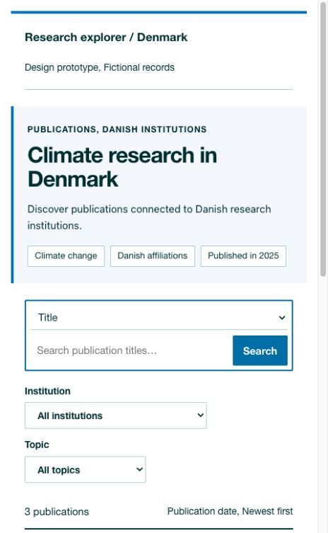
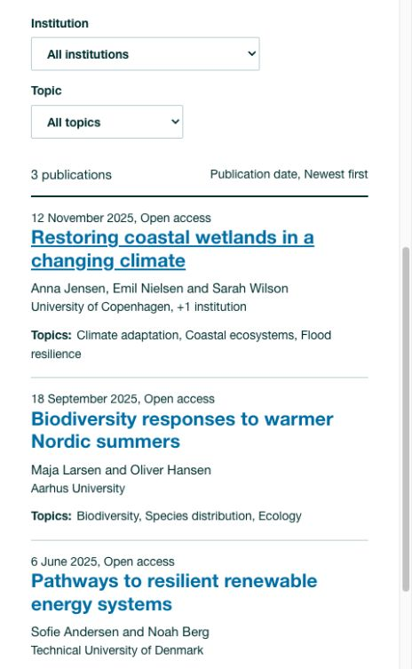
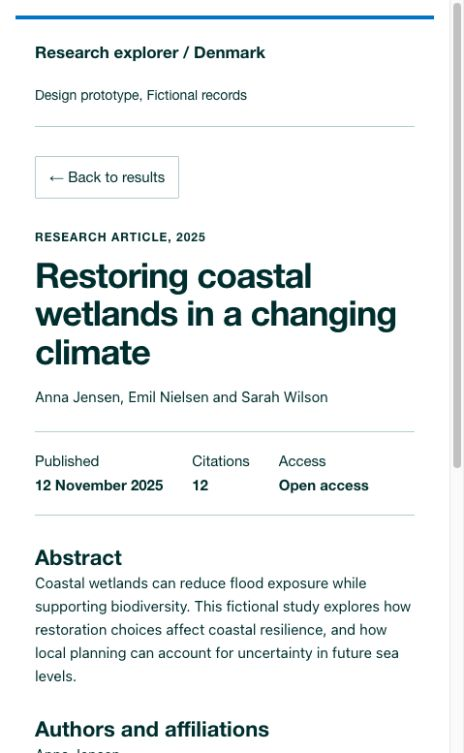

# Visual handoff

Use this reference alongside the UX decisions and publication model in the project README. All records in the prototype are fictional. This is a design exploration, not production frontend code.

## Screenshots

Screenshots capture a narrow browser viewport; they are viewport excerpts rather than full-page images.

### Search and filters

### Result grouping and spacing

### Publication details

## Interactive reference

Open [prototype.html](prototype.html) in a browser. It includes its styles, fictional data and local search/filter/detail interactions. No OpenAlex requests or API key are needed. It may use the system font fallback when DIN Next is unavailable.

## Guidance for continuing implementation

- Build the React frontend in small vertical slices with the user. Do not copy the prototype wholesale into the application or generate the whole app at once.
- The search-list direction has been iteratively reviewed. Preserve the three result groups, comma-separated topics, high-contrast text, blue accents and discreet clear-filters action described in the root README.
- The detail screen is an initial layout and has not received the same detailed review. It still uses a topic badge and placeholder publication links; align topics with the agreed plain-text treatment and implement real links.
- Loading skeletons, retryable errors and empty-result behaviour are agreed requirements, not complete prototype features. Pagination controls are placeholders.
- The prototype's search and filter logic is illustrative. Implement real queries in Hono with the fixed scope and keep the API key server-side.
- Screenshots are a snapshot. Update this reference when design decisions change.
